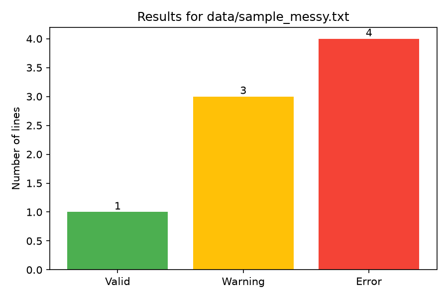

# ObsCheck

A command-line tool that validates raw classroom observation text files,
labels every line as Valid, Warning or Error, stores the results in SQLite
and exports a CSV report.

Personal learning project, inspired by a classroom-observation use case.

## Features

- Detects the file encoding automatically
- Validates each line (time, student ID, activity, observer)
- Three result levels: Valid, Warning, Error
- Keeps the original raw line unchanged in the database
- Exports a CSV report
- Exports a colour-coded Excel report
- Unit tests with pytest
- Draws a chart of the results with Matplotlib
## Example result

## Input format

Each line has four fields separated by semicolons:

    timestamp;student_id;activity;observer
    09:00:05;S01;Passive;Obs1

Allowed activities: Passive, Active, Constructive, Interactive.

## Validation rules

| Result | Examples |
|---|---|
| Valid | all four fields correct |
| Warning | wrong capitalisation, extra spaces, missing observer |
| Error | wrong number of fields, impossible time, unknown activity, empty student ID |

## Setup

    python -m venv .venv
    .venv\Scripts\activate
    pip install -r requirements.txt

## Usage

    python src/main.py data/sample_messy.txt

## Run the tests

    pytest

## Tech

Python, pandas, openpyxl, SQLite, charset-normalizer, pytest, matplotlib

## What I learned

I built this project to practise Python on a realistic data-quality problem:
checking raw text files line by line and deciding whether each line is Valid,
a Warning (fixable) or an Error (unusable).

- **Git and GitHub:** I set up a virtual environment, made small commits and
  pushed them to GitHub. I also fixed mistakes with files in the wrong folder.
- **Encoding:** Files are bytes, and the encoding decides how they become
  text. I detect it first with charset-normalizer instead of guessing.
- **Validation:** I defined my own Valid/Warning/Error rules first, then
  turned them into code. My first attempt got two lines wrong (an impossible
  time and extra spaces), which taught me to check values and not just format.
- **SQLite:** I store every result and keep the original raw line unchanged,
  so the data stays traceable.
- **Testing:** I wrote 9 pytest tests, one for each rule, so I notice
  immediately if a change breaks something.
- **Debugging:** Excel on my PC splits CSV columns at commas, not semicolons,
  so I reverted my first export setting after testing it.

Next I want to add a simple window (GUI) with PySide6